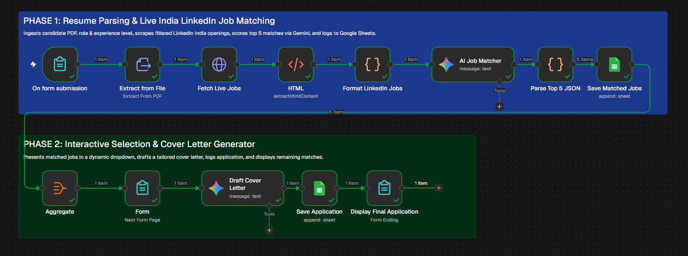

# 🤖 Autonomous AI Job Matcher & Application Generator


An end-to-end, human-in-the-loop AI automation system built using **n8n, Google Gemini, and Google Sheets**. The platform automatically analyzes PDF resumes, discovers job opportunities across India, evaluates candidate-job compatibility using AI, and generates personalized cover letters for selected positions.

It simplifies the job application process by combining resume parsing, automated job discovery, intelligent matching, and application generation into a single workflow.



---

## ✨ Key Features

- **📄 Automated Resume Parsing:** Extracts text and relevant candidate information directly from uploaded PDF resumes using n8n's Extract from File node.
- **🔍 Automated Job Discovery:** Fetches publicly accessible LinkedIn job listings based on the candidate's preferred role, location, and experience level.
- **🎯 Experience-Based Filtering:** Supports three experience categories:
  - Fresher (0–2 Years)
  - Intermediate (2–5 Years)
  - Senior (5+ Years)
- **🧠 AI-Powered Job Matching:** Uses Google Gemini to analyze resumes, evaluate job requirements, calculate compatibility scores, and rank the top 5 opportunities.
- **🛡️ Self-Healing JSON Parsing:** Handles inconsistent AI-generated JSON responses to improve workflow reliability.
- **🙋 Human-in-the-Loop Selection:** Displays matched opportunities through an interactive selection form, allowing candidates to choose their preferred position.
- **✍️ Personalized Cover Letter Generation:** Generates a tailored cover letter based on the candidate's resume and selected job description.
- **📊 Automated Google Sheets Logging:** Stores matched job opportunities and generated applications in separate spreadsheet tabs.
- **🔗 Quick-Apply Directory:** Displays direct application links for the selected position and other recommended opportunities.

---

## 🏗️ Workflow Architecture

The automation pipeline consists of two interconnected phases.

### Phase 1 — Resume Parsing & AI Job Matching

Processes the uploaded resume and identifies the most relevant job opportunities.

```text
Form Trigger
     ↓
Extract PDF Text
     ↓
Fetch Live LinkedIn Jobs
     ↓
HTML Parser & Formatter
     ↓
Gemini AI Job Matcher
     ↓
Self-Healing JSON Parser
     ↓
Save Matched Jobs to Google Sheets
```

**What happens in this phase?**

1. Candidate uploads their PDF resume through an n8n form.
2. The workflow extracts the resume text.
3. Job listings are retrieved based on the target role and experience level.
4. Job information is cleaned and formatted.
5. Google Gemini compares the resume with available job descriptions.
6. The AI ranks the top 5 matching opportunities and provides compatibility scores with explanations.
7. All matched opportunities are saved in Google Sheets.

### Phase 2 — Interactive Job Selection & Application Generation

Allows candidates to select a suitable opportunity and generate a personalized application.

```text
Aggregate Matches
       ↓
Dynamic Job Selection Form
       ↓
Candidate Selects a Job
       ↓
Gemini Cover Letter Writer
       ↓
Save Application to Google Sheets
       ↓
Display Generated Cover Letter
       ↓
Show Remaining Job Opportunities
```

**What happens in this phase?**

1. The top 5 matched opportunities are presented in a dynamic dropdown form.
2. The candidate selects their preferred job.
3. Google Gemini generates a customized cover letter.
4. The selected application is saved in Google Sheets.
5. The final output displays the cover letter, selected job's application link, and the remaining 4 recommended opportunities.

---

## 🛠️ Tech Stack

| Layer | Technology | Purpose |
|---|---|---|
| Workflow Orchestration | n8n Cloud | Workflow automation, triggers, and form handling |
| AI / LLM | Google Gemini (`gemini-2.5-flash`) | Resume analysis, job matching, and cover letter generation |
| Data Extraction | HTTP Request + HTML Parser | Retrieving and processing publicly accessible job listings |
| Resume Processing | PDF + Extract from File | Extracting candidate information from resumes |
| Database / Storage | Google Sheets API | Storing matched jobs and generated applications |
| Job Source | LinkedIn Public Job Feed | Discovering job opportunities |

---

## ⚙️ Setup & Installation

Follow these steps to configure and run the project.

### 1. Prerequisites

Make sure you have:

- An active n8n Cloud account or self-hosted n8n instance.
- A Google account.
- A Google Gemini API key.
- Access to Google Sheets API through n8n credentials.
- The exported `ai-job-matcher-workflow.json` file.

### 2. Prepare Google Sheets

Create a new Google Spreadsheet named:

**`AI Job Matcher`**

Create two separate tabs with the following exact names and column headers.

**Tab 1: Matched Jobs**

| Column | Description |
|---|---|
| Job_ID | Unique job identifier |
| Title | Job position |
| Company | Hiring organization |
| Match_Score | AI-generated compatibility score |
| Reason | Explanation of the match |
| URL | Job application or listing URL |
| Resume_Summary | Summary of the candidate's resume |

Use these exact column headers:

```text
Job_ID | Title | Company | Match_Score | Reason | URL | Resume_Summary
```

**Tab 2: Applications**

| Column | Description |
|---|---|
| Job_ID | Selected job identifier |
| Title | Selected job position |
| Company | Hiring organization |
| Status | Application status |
| Tailored_Cover_Letter | AI-generated cover letter |
| Apply_URL | Direct application URL |

Use these exact column headers:

```text
Job_ID | Title | Company | Status | Tailored_Cover_Letter | Apply_URL
```

### 3. Import the n8n Workflow

1. Download `ai-job-matcher-workflow.json` from this repository.
2. Open your n8n dashboard.
3. Create a new workflow.
4. Click the three-dot (`...`) menu in the top-right corner.
5. Select **Import from File**.
6. Choose the downloaded JSON workflow.
7. Verify that all nodes and connections are imported correctly.

### 4. Configure API Credentials

**Google Gemini API**

1. Generate an API key through Google AI Studio.
2. Open the `AI Job Matcher` node.
3. Configure your Google Gemini credentials.
4. Repeat the process for the `Draft Cover Letter` node.
5. Ensure the configured model is `gemini-2.5-flash`.

**Google Sheets OAuth2**

1. Open the `Save Matched Jobs` node.
2. Connect your Google account using OAuth2.
3. Select the `AI Job Matcher` spreadsheet.
4. Choose the `Matched Jobs` worksheet.
5. Repeat the configuration for the `Save Application` node.
6. Select the `Applications` worksheet.

**Important:** Verify that all spreadsheet column names match the workflow configuration.

---

## 🚀 How to Run the Workflow

### Step 1: Publish the Workflow

- Save your imported workflow.
- Click **Publish** in the n8n editor.
- Ensure the workflow is active and its production form URL is available.

### Step 2: Open the Resume Submission Form

1. Open the `On form submission` trigger node.
2. Navigate to the **Production URL** section.
3. Copy and open the production form URL in your browser.

**Note:** Always start from the main `/form/...` URL rather than refreshing an intermediate `/form-waiting/...` URL.

### Step 3: Upload Resume & Enter Preferences

Fill in the required information:

- **Resume:** Upload your resume in PDF format.
- **Target Role:** Enter your preferred job title.
  - Example: Software Engineer
  - Example: Python Developer
  - Example: UI/UX Designer
- **Experience Level:** Select your experience category.
  - Fresher (0–2 Years)
  - Intermediate (2–5 Years)
  - Senior (5+ Years)

Click **Submit** to start the automation.

### Step 4: Review & Select a Job

- Wait approximately 10–20 seconds, depending on workflow execution and job-source availability.
- The AI analyzes your resume against the retrieved job opportunities.
- The top 5 matches are presented in a second-stage interactive dropdown form.
- Review the match scores and select your preferred job.
- Click **Submit**.

### Step 5: Generate Your Cover Letter

Once you select a job:

- Google Gemini generates a personalized cover letter.
- The generated application is automatically saved to Google Sheets.
- The final screen displays your tailored cover letter.
- A direct application link is provided for the selected position.
- Links to the remaining 4 matched opportunities are also displayed.

**That's it!** Your job discovery, matching, and cover letter generation process is automated.

---

## 📊 Google Sheets Data Management

The project maintains two separate worksheets for organized application tracking.

| Worksheet | Stored Information |
|---|---|
| Matched Jobs | All AI-ranked job opportunities, compatibility scores, and matching explanations |
| Applications | Selected jobs, generated cover letters, application status, and application links |

This makes it easier to review opportunities, track applications, and maintain a centralized record of your job search.

---

## 📂 Repository Structure

```text
AI-Job-Matcher/
│
├── README.md
│
├── ai-job-matcher-workflow.json
│
└── assets/
    └── workflow-architecture.png
```

| File / Folder | Description |
|---|---|
| `README.md` | Project documentation and setup instructions |
| `ai-job-matcher-workflow.json` | Importable n8n workflow configuration |
| `assets/` | Project images and workflow architecture diagram |

---

## 🔐 Security & Reliability Considerations

- Keep your Google Gemini API key and OAuth credentials private.
- Never upload API keys or sensitive credentials to GitHub.
- Use n8n's credential manager to securely store authentication details.
- Handle uploaded resumes and candidate information responsibly.
- Validate AI-generated job matches and cover letters before applying.
- Public job-feed availability and structure may change, so scraping nodes might require maintenance.
- Verify job details and application URLs on the employer's official careers page before submitting an application.

---

## ⚠️ Limitations

- Job discovery depends on the availability and accessibility of publicly accessible LinkedIn job listings.
- Scraped job information may be incomplete or outdated.
- AI-generated match scores are estimates, not guarantees of hiring suitability.
- Cover letters may require manual editing before submission.
- The workflow generates application materials but does not automatically submit applications on behalf of candidates.

---

## 🔮 Future Enhancements

Potential improvements for future versions include:

- [ ] Integration with additional job platforms such as Indeed and Naukri.
- [ ] Automated resume improvement and ATS compatibility analysis.
- [ ] Job alerts through email or WhatsApp.
- [ ] Application status tracking and follow-up reminders.
- [ ] Candidate dashboard with application analytics.
- [ ] Support for DOCX resumes.
- [ ] Advanced job recommendations based on candidate preferences.
- [ ] Duplicate job detection and filtering.

---

## 👨‍💻 Author

**Developed as an AI-powered job search automation project.**

Built with ❤️ using n8n, Google Gemini, and Google Sheets.

---

## ⭐ Support

If you find this project useful, consider giving the repository a ⭐ on GitHub!

Contributions, suggestions, and feedback are always welcome.

**Happy Job Hunting! 🚀**
